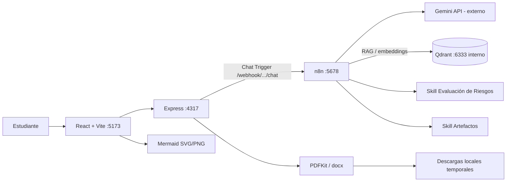

# Arquitectura ISO Studio

### Separación de responsabilidades

- **React**: diseño visual, chat, historial local en pestaña, botones de exportación y render Mermaid.
- **Express**: proxy local al chat n8n, control de entradas, creación de PDF/DOCX y entrega temporal de archivos.
- **n8n**: orquestación, Gemini, memoria, herramientas y flujos RAG.
- **Skills**: documentos de procedimiento devueltos como texto por subworkflows de n8n; no son plugins ejecutables autónomos.
- **Qdrant**: almacén persistente de documentos y vectores; requiere embeddings consistentes en indexación y consulta.

### Flujos n8n

1. Agente: `When chat message received → AI Agent → (Gemini, Simple Memory, Qdrant Tool, Skill Riesgos, Skill Artefactos)`.
2. RAG: `Cargar norma ISO 27701 → Qdrant Insert Documents` con `Embeddings Google Gemini`, `Default Data Loader` y `Recursive Character Text Splitter`.
3. Skill Riesgos: subworkflow que devuelve instrucciones de evaluación y formato.
4. Skill Artefactos: subworkflow que devuelve instrucciones de generación de Markdown y Mermaid.

### Datos persistentes

- `n8n_data`: SQLite/configuración de n8n y credenciales cifradas.
- `qdrant_data`: índices y vectores Qdrant.
- `frontend/.local-artifacts/`: archivos temporales generados por Express (no persistencia corporativa).

Los volúmenes se conservan al reiniciar/actualizar servicios mientras no se eliminen expresamente. **El repositorio no incluye estas bases de datos.**
